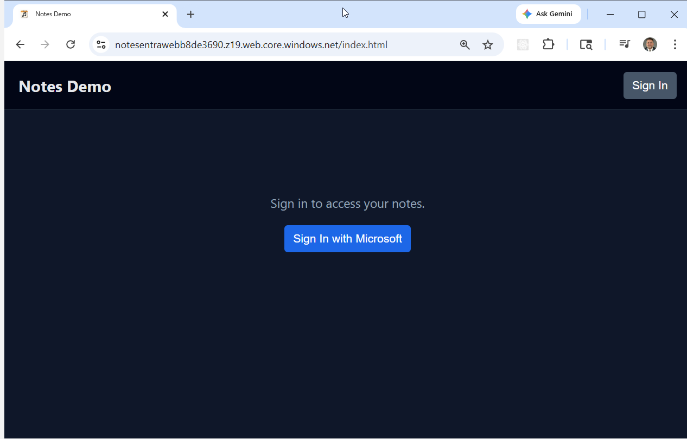

# Authenticated CRUD API on Azure: Entra External ID, Functions and Cosmos DB

The [azure-crud-example](https://github.com/mamonaco1973/azure-crud-example)
notes API with sign-in added. Users sign in through a **Microsoft Entra
External ID** user flow, every HTTP function in a **Flex Consumption
Function App** validates their token before doing anything, and each user's
notes are kept separate in **Cosmos DB** by their Entra user ID. A
single-page web app on a **storage static website** handles the sign-in and
calls the API.



| Piece | Where | Role |
|---|---|---|
| **notes-entra-app** | Entra External ID tenant | SPA app registration (authorization code with PKCE, v2 access tokens), redirect to `callback.html`; `apply.sh` adds it to your sign-up/sign-in user flow |
| **notes-entra-func-&lt;hex&gt;** | `notes-entra-rg`, Central US | Function App on the `FC1` plan (`notes-entra-plan`), Python 3.11, up to 50 instances; five anonymous HTTP functions that validate the bearer token themselves; CORS allows only the web origin |
| **notes-b2c-cosmos-&lt;hex&gt;** | Cosmos DB | database and container `notes`, partitioned on `/owner`, 400 RU/s |
| **notesentraweb&lt;hex&gt;** | Storage | static website with `index.html`, `callback.html`, `config.json` and `favicon.ico` |
| **notesentrafunc&lt;hex&gt;** / **notes-entra-ai** | `notes-entra-rg` | deployment package storage, and Application Insights |

## Architecture

<picture>
  <source media="(prefers-color-scheme: dark)" srcset="architecture-dark.svg">
  
</picture>

Regenerate with `python3 make_diagram.py`.

- **`01-functions/`**: the resource group, the Entra app registration
  (`entra.tf`, applied with a service principal in the External tenant),
  Cosmos DB, both storage accounts, the Function App, and the code in
  `code/function_app.py`.
- **`02-webapp/`**: `index.html.tmpl`, `callback.html` and the upload of the
  rendered files and `config.json`.

## How sign-in works

1. The page sends the user to the External tenant's user flow with a PKCE
   challenge; `callback.html` exchanges the code for tokens and keeps them
   in `sessionStorage`.
2. Every API call sends the access token as `Authorization: Bearer <token>`.
3. Each function checks the token's RS256 signature against the tenant's
   JWKS (cached while the instance is warm), that the audience is
   `notes-entra-app`, and the expiry; otherwise it returns `401`.
4. It uses the `sub` claim (or `oid`) as the `owner` partition key, so users
   only see and change their own notes.

## API

Routes are under `/api`; every route needs a valid Entra access token.

| Method | Path | Returns |
|---|---|---|
| POST | `/api/notes` | `201` `{id, title, note}`; `400` if `title` is missing |
| GET | `/api/notes` | `{"items": [...]}` for this user |
| GET | `/api/notes/{id}` | the note, or `404` |
| PUT | `/api/notes/{id}` | the updated note; `404` if it doesn't exist |
| DELETE | `/api/notes/{id}` | `{"message": "Note deleted"}`, even if it didn't exist |

## Prerequisites

* [An Azure Account](https://portal.azure.com/)
* [Install AZ CLI](https://learn.microsoft.com/en-us/cli/azure/install-azure-cli)
* [Install Terraform](https://developer.hashicorp.com/terraform/install)
* [Install jq](https://jqlang.github.io/jq/download/), `zip` and `envsubst`

### One-time Entra External ID setup

Do this in the Azure portal before the first deploy:

1. **Create an External tenant.** Microsoft Entra ID > Overview > Manage
   tenants > New, type **External**. Its subdomain (`mynotesapp` in
   `mynotesapp.onmicrosoft.com`) is `ENTRA_TENANT_NAME`; its tenant ID is
   `ENTRA_TENANT_ID`.
2. **Create a user flow.** In the External tenant, External Identities >
   User flows > New user flow > **Sign up and sign in**, with **Email with
   password**, collecting and returning **Email Address**. Its name is
   `ENTRA_USER_FLOW_NAME`.
3. **Create a service principal in that tenant.** App registrations > New
   registration; add a client secret; add the Microsoft Graph application
   permissions `Application.ReadWrite.All` and `EventListener.ReadWrite.All`
   and grant admin consent. Its client ID and secret are
   `ENTRA_SP_CLIENT_ID` and `ENTRA_SP_CLIENT_SECRET`.

### Environment variables

```bash
# Azure subscription
export ARM_CLIENT_ID="..."
export ARM_CLIENT_SECRET="..."
export ARM_SUBSCRIPTION_ID="..."
export ARM_TENANT_ID="..."

# Microsoft Entra External ID
export ENTRA_TENANT_ID="..."           # GUID of the External tenant
export ENTRA_TENANT_NAME="mynotesapp"  # Domain prefix only (no .onmicrosoft.com)
export ENTRA_SP_CLIENT_ID="..."        # Service principal registered IN the External tenant
export ENTRA_SP_CLIENT_SECRET="..."
export ENTRA_USER_FLOW_NAME="..."      # Display name of the sign-up/sign-in user flow
```

If this is your first time following along, we recommend starting with this
video: [Azure + Terraform: Easy Setup](https://youtu.be/wwi3kVgYNOk).

## Deploy

```bash
git clone https://github.com/mamonaco1973/azure-entra-app.git
cd azure-entra-app
./apply.sh
```

`apply.sh` applies `01-functions`, gets a Microsoft Graph token as the
External tenant's service principal and adds `notes-entra-app` to the user
flow (retrying while the new app propagates), zips and deploys the function
code with a remote build, writes `config.json` (API URL, client ID,
authority), and applies `02-webapp`. It ends by running `validate.sh`, which
prints the URLs:

```
=================================================================================
  Deployment validated!
=================================================================================
  API : https://notes-entra-func-<hex>.azurewebsites.net/api
  Web : https://notesentraweb<hex>.z19.web.core.windows.net/index.html
=================================================================================
```

## Try it

1. Open the **Web** URL, sign in, and create an account in the user flow
   with your email.
2. Add, edit and delete notes. Sign in as a second user to see that each
   account has its own notes.
3. Call the API without a token and you get `401`:

   ```bash
   curl -i https://notes-entra-func-<hex>.azurewebsites.net/api/notes
   ```

## Teardown

```bash
./destroy.sh
```

## Notes

- **Lab only.** Anyone can sign up through the user flow.
- The Cosmos DB primary key is in a plain app setting (`COSMOS_KEY`) rather
  than using a managed identity.
- The token check verifies the signature, audience and expiry, but not the
  issuer.
- The Cosmos DB account is named `notes-b2c-cosmos-*`, a leftover from an
  Azure AD B2C version; it's Entra External ID now.
